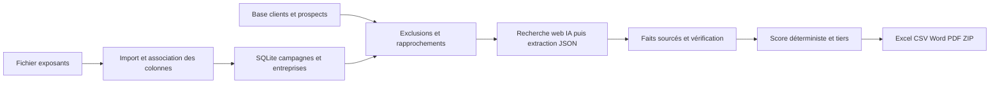

# IMPACT Prospection salons avec Streamlit

L’application transforme un fichier d’exposants en campagne de prospection : import, exclusions clients/prospects, recherche IA, score explicable, classement en trois tiers, fiches mémos et base de contacts. Le scraping est réalisé en dehors de l’application.

Une **campagne** est un dossier de travail pour un salon et son édition, par exemple « SIRHA Marseille · 2027 ». Elle regroupe votre fichier d’exposants, vos critères, le classement, les contacts et les fiches mémos. Créer une campagne ne déclenche aucun envoi ni appel IA.

## Lancer

Sous Windows, double cliquer sur **Lancer_IMPACT.cmd**. Python 3.11 ou supérieur est nécessaire. Le lanceur crée un environnement virtuel et installe les dépendances à la première utilisation.

L’adresse locale est **http://127.0.0.1:8765**. L’application reste locale. Laisser le processus ouvert pendant les recherches et arrêter avec Ctrl+C.

En terminal PowerShell depuis ce dossier :

```powershell
python -m venv .venv
.venv/Scripts/python.exe -m pip install -r requirements.txt
.venv/Scripts/python.exe -m streamlit run app.py --server.address 127.0.0.1 --server.port 8765
```

Utiliser le lanceur ou le Python de `.venv` pour conserver les versions du projet. Une commande `streamlit run app.py` seule peut utiliser une autre installation de Streamlit sur le PC. L’erreur `TypeError: 'str' object cannot be interpreted as an integer` sur la largeur du tableau provenait de Streamlit 1.43.2, qui n’accepte pas `width='stretch'`. L’affichage est désormais compatible avec cette version et avec la 1.65.0 du projet ; le lanceur vérifie aussi la version installée dans `.venv`.

## Connexion et comptes

L’écran de connexion précède les lectures de campagnes et les commandes de l’interface. Chaque compte local possède un email et un mot de passe propre à IMPACT. Le compte initial configuré est `triva@adv-sud.fr`. Le mot de passe généré est communiqué séparément et n’est pas présent dans le code.

En mode local, les comptes et sessions sont enregistrés dans `data/auth.sqlite3`, séparément des campagnes. Avec Supabase configuré, ils sont conservés dans le schéma privé `impact_auth` de PostgreSQL. Les mots de passe utilisent PBKDF2 SHA-256 avec 600 000 itérations et un sel aléatoire. Seule l’empreinte des jetons de session est conservée en base. Le fichier SQLite privé est ignoré par Git avec le dossier `data` et doit rester accessible uniquement au serveur et à son administrateur.

La session expire après 30 minutes d’inactivité ou huit heures au maximum. Les mises à jour automatiques du classement ne prolongent pas l’inactivité. Rafraîchir entièrement le navigateur ouvre une nouvelle session Streamlit et demande une nouvelle connexion. Le bouton **Se déconnecter** révoque la session et efface ses imports et exports en mémoire. Les recherches déjà lancées continuent sur le serveur.

Cinq échecs de connexion sur une adresse entraînent un blocage temporaire de cinq minutes, partagé entre navigateurs. Une seconde limite globale freine les essais sur des adresses différentes. Les réponses de connexion ne révèlent pas l’existence d’un compte. Le serveur vérifie aussi les sessions lors des mises à jour des fragments et du dialogue du score.

Gestion des comptes sur le serveur, sans redémarrer ni modifier le code :

```powershell
.venv/Scripts/python.exe tools/manage_users.py add collegue@entreprise.fr
.venv/Scripts/python.exe tools/manage_users.py add autre@entreprise.fr --generate-password
.venv/Scripts/python.exe tools/manage_users.py reset-password collegue@entreprise.fr
.venv/Scripts/python.exe tools/manage_users.py disable collegue@entreprise.fr
.venv/Scripts/python.exe tools/manage_users.py enable collegue@entreprise.fr
.venv/Scripts/python.exe tools/manage_users.py list
```

Sans `--generate-password`, le terminal demande le mot de passe sans l’afficher. Le renouvellement du mot de passe et la désactivation révoquent les sessions de ce compte. Tous les comptes autorisés disposent actuellement du même accès aux campagnes ; aucune inscription publique n’est proposée.

Le lanceur Windows reste lié à `127.0.0.1`. Pour un déploiement distant, utiliser HTTPS et une protection d’accès au niveau du serveur ou du proxy, y compris pour les téléchargements et WebSockets. Le contrôle Streamlit protège les écrans et actions de l’application, mais ne constitue pas un contrôle distinct des URL de fichiers temporaires déjà émises. Un fichier déjà téléchargé reste sur le PC de son destinataire.

## Déployer sur Streamlit Community Cloud

Le dépôt contient le thème et les options communes dans `.streamlit/config.toml`, sans adresse ni port imposé. Community Cloud choisit ses paramètres réseau ; le lanceur Windows garde ses arguments locaux. Dans Streamlit, sélectionner le dépôt, la branche `main` et le fichier `app.py`. Les dépendances sont dans `requirements.txt`.

Les comptes locaux et les campagnes dans `data/`, ainsi que `.env`, ne sont pas envoyés sur GitHub. Une nouvelle instance Cloud démarre donc sans campagne ni compte. Pour conserver le même identifiant et le même mot de passe sans publier leur empreinte dans le dépôt :

1. Exécuter `.venv/Scripts/python.exe tools/export_cloud_login.py` sur le PC. Le fichier privé `outputs/cloud_deployment/secrets.toml` est créé avec les comptes actifs et les empreintes existantes ; aucun mot de passe en clair, jeton de session ou clé IA n’est exporté.
2. Dans Streamlit, ouvrir **Manage app → Settings → Secrets**, coller ce fichier, puis enregistrer. Si d’autres secrets existent, conserver leurs entrées et ajouter uniquement `IMPACT_AUTH_USERS_JSON`.
3. Après redémarrage, se connecter avec le compte IMPACT habituel. Les comptes déclarés dans ce secret constituent la liste autorisée sur Cloud. Une modification de mot de passe ou une désactivation révoque les sessions concernées au chargement de la nouvelle configuration. Une configuration invalide bloque l’accès.

Pour ajouter une clé IA, utiliser également les secrets Streamlit, à la racine du TOML, par exemple `GEMINI_API_KEY = "..."`, `GEMINI_TIER = "free"`, `WEB_SEARCH_PROVIDER = "direct"` et `AI_PROVIDER = "gemini"`. Voir `.streamlit/secrets.example.toml`. Une clé détectée ne garantit ni le quota ni la gratuité du compte. Aucun appel IA n’est effectué au démarrage.

**Ollama sur le PC n’est pas accessible depuis Community Cloud** : `127.0.0.1` désigne alors le serveur Cloud. Utiliser un fournisseur distant configuré pour la recherche IA en ligne. Le présent déploiement ne transfère pas les clés du PC ni les résultats SIRHA.

**Conservation des données :** sans `IMPACT_DATABASE_URL`, la base SQLite sur le disque Community Cloud ne constitue pas un stockage durable garanti. Configurer Supabase comme ci-dessous pour conserver les campagnes et les comptes à distance. Les exports restent régénérables depuis les données enregistrées.

## Supabase : base distante persistante et reprise des résultats locaux

L'application accepte PostgreSQL (dont Supabase) avec une seule variable privée, `IMPACT_DATABASE_URL`. Les campagnes, entreprises, résultats, cache, réglages, journal d'audit et traitements sont stockés dans le schéma privé `impact`. Les comptes, empreintes de mots de passe, sessions et limites de connexion sont stockés dans `impact_auth`. Ces schémas sont séparés du schéma public et du service Supabase Auth. Aucune clé `anon` ni `service_role` n'est nécessaire : seul le serveur Streamlit accède à PostgreSQL.

1. Dans Supabase, créer un projet dédié **IMPACT** dans l'organisation et l'offre souhaitées. Le mot de passe de base de données est distinct du mot de passe IMPACT.
2. Dans le projet, ouvrir **Connect → Session pooler**, copier l'URI fournie et remplacer `[YOUR-PASSWORD]` par le mot de passe de la base. Encoder les caractères réservés du mot de passe dans l'URI. Copier l'hôte, le port et l'utilisateur exacts indiqués par Supabase ; ne pas les reconstituer.
3. Dans **Streamlit → Manage app → Settings → Secrets**, ajouter `IMPACT_DATABASE_URL = "postgresql://.../postgres?sslmode=require"` à la racine du TOML, en conservant `IMPACT_AUTH_USERS_JSON` et les autres secrets. L'application crée ses tables privées à la première connexion. Une indisponibilité de PostgreSQL bloque l'accès ; elle ne crée pas silencieusement une nouvelle base SQLite vide.
4. Pour reprendre la base locale, renseigner la même variable dans `.env` sur le PC, sans la publier ni l'envoyer dans un message. Faire d'abord la simulation, puis la copie décrite ci-dessous. Pendant la migration, ne pas importer de campagne dans la destination.

```powershell
.venv/Scripts/python.exe -m pip install -r requirements.txt
# Simulation locale : aucun accès à Supabase et aucun appel IA.
.venv/Scripts/python.exe tools/migrate_to_supabase.py
# Copie réelle vers IMPACT_DATABASE_URL ; destination métier vide obligatoire.
.venv/Scripts/python.exe tools/migrate_to_supabase.py --apply
```

La source SQLite est ouverte en lecture seule et copiée à partir d'un snapshot cohérent. Les identifiants, critères, décisions commerciales, faits, sources, mémos, historiques, statuts d'erreur et résultats en cache sont conservés. Toutes les valeurs copiées sont comparées avant validation de la transaction. Une destination déjà utilisée est refusée sans écrasement. Rejouer exactement la même migration ne duplique pas les données. La migration n'effectue **aucun appel IA** et ne relance aucun traitement.

Les comptes Cloud sont créés depuis `IMPACT_AUTH_USERS_JSON` dans la base distante ; les sessions locales ne sont pas transférées. Les clés IA restent uniquement dans `.env` ou les Secrets Streamlit. Une fois le transfert terminé, rafraîchir la page puis préparer de nouveaux exports dans l'application : aucun besoin de refaire les recherches pour retrouver les résultats existants.

La connexion utilise SSL, un pool borné à quatre connexions et des transactions. Les schémas privés retirent les droits publics, `anon` et `authenticated`, et activent RLS sans politique publique. Utiliser la connexion serveur fournie dans **Connect** ; ne pas exposer ces identifiants dans le navigateur. Une base persistante ne remplace pas les sauvegardes et ne fait pas continuer un calcul IA lorsque le processus Streamlit s'arrête. Les résultats déjà enregistrés restent disponibles et les recherches inachevées sont reprenables.

Sans variable distante, l'application conserve le mode SQLite local. Pour revenir au mode local sur le PC, retirer `IMPACT_DATABASE_URL` de `.env` et de l'environnement, puis redémarrer l'application : les fichiers SQLite d'origine sont conservés. Ne pas faire tourner les tests unitaires avec une adresse de production ; les tests PostgreSQL utilisent une base de test séparée.

Références : [Connexion PostgreSQL / Session pooler](https://supabase.com/docs/guides/database/connecting-to-postgres), [offres et limites actuelles](https://supabase.com/pricing).

## Ajouter la clé après

Copier `.env.example` vers `.env`, puis remplir :

```dotenv
OPENAI_API_KEY=votre_cle_api
OPENAI_MODEL=gpt-5.5
```

Redémarrer l’application. Cet exemple active OpenAI. Un modèle OpenAI différent peut être choisi s’il est disponible sur votre compte et compatible avec Responses, recherche web et sorties JSON structurées. Une clé détectée ne prouve pas que le compte, le modèle ou le quota sont utilisables.

Une variable d’environnement existante a priorité sur `.env`. Si la clé semble inchangée, retirer ou remplacer la variable du processus avant de relancer. La clé ne passe pas dans le navigateur, les exports ni la base SQLite. `.env` est ignoré par Git.

Sans IA, l’import de tableaux, les critères, la vérification manuelle, le classement à partir des données disponibles et les exports fonctionnent. L’extraction d’un document libre peut aussi être effectuée avec un modèle Ollama local sans clé de calcul. La recherche web nécessite la configuration du service choisi. Aucun appel réel à l’IA n’est déclenché automatiquement au lancement.

Les mémos sans IA reprennent les données importées ou saisies ; les renseignements absents restent manquants et le pitch personnalisé n’est pas généré. Pour automatiser la recherche et la rédaction commerciale, configurer l’une des solutions ci-dessous.

## Choisir entre les trois solutions IA

Choisir **Solution IA** dans la barre latérale, puis ouvrir **Configuration IA**. Le choix est conservé localement. Les critères métier, exclusions, classement, validation et exports sont communs aux trois solutions. La mention « priorité performance » indique l’usage visé d’OpenAI ; la qualité comparative doit être mesurée sur un pilote, elle n’est pas garantie.

| Solution | À préparer | Coût et limites |
|---|---|---|
| OpenAI | `OPENAI_API_KEY` avec un compte API crédité ; modèle GPT-5.5 ou GPT-5.4 mini | Facturation IA et recherche web à l’usage. Aucun gros calcul sur le PC. |
| Ollama local | Application Ollama et modèle local ; aucune clé en lecture directe, ou clé du service web choisi | Pas de frais de tokens. La lecture directe reste limitée aux sites connus et à leurs accès autorisés. |
| Gemini Flash-Lite | `GEMINI_API_KEY` ; vérifier le quota gratuit dans AI Studio ; même choix de service web qu’Ollama | Analyse gratuite seulement si le compte relève de l’offre gratuite et de ses quotas ; offre payante déclarable. Les contenus gratuits peuvent servir à améliorer les produits Google. |

### Ollama local

Installer [Ollama](https://ollama.com/download), démarrer son application, puis télécharger un modèle si nécessaire :

```powershell
ollama pull qwen3:8b
```

Dans **Configuration IA**, **Détecter les modèles locaux** permet aussi d’utiliser un modèle déjà présent, puis **Utiliser ce modèle local** enregistre le choix. Aucun téléchargement ni aucune génération ne sont déclenchés par cette détection. Le modèle par défaut est un point de départ ; le modèle utilisable et sa vitesse dépendent du PC. Le serveur accepté est local (`127.0.0.1`, `localhost` ou `::1`). Cette option exclut les modèles cloud pour éviter une facturation de calcul inattendue.

```dotenv
OLLAMA_BASE_URL=http://127.0.0.1:11434
OLLAMA_MODEL=qwen3:8b
OLLAMA_TIMEOUT=300
OLLAMA_API_KEY=votre_cle_web_ollama
```

La clé web se crée dans le [compte Ollama](https://ollama.com/settings/keys). Le calcul local et le service web sont distincts : le premier ne nécessite pas de clé de calcul, le second nécessite un compte et une clé. Sa gratuité est limitée, et un quota permettant de garantir 4 000 dossiers complets n’est pas supposé.

### Gemini avec quota gratuit

Créer une clé dans [Google AI Studio](https://aistudio.google.com/api-keys), puis renseigner :

```dotenv
GEMINI_API_KEY=votre_cle_gemini
GEMINI_MODEL=gemini-3.5-flash-lite
GEMINI_TIER=free
OLLAMA_API_KEY=votre_cle_web_ollama
```

L’offre `free` est une déclaration pour l’estimation : elle ne désactive pas la facturation d’un compte Google déjà payant. Vérifier le compte dans AI Studio. La connexion utilise l’API Interactions avec `store=false`, sans recherche Google payante intégrée. Les pages sont fournies par le service web choisi. En cas de quota atteint, le lot s’arrête ; aucun autre fournisseur ni modèle payant n’est appelé automatiquement.

### Recherche web pour Ollama et Gemini

Choisir dans **Configuration IA** entre **Lecture des sites fournis**, **Ollama web** et **Serper**. Pour Serper, renseigner `SERPER_API_KEY` dans `.env` et acheter des crédits si nécessaire. La recherche et la lecture des pages Ollama utilisent les API officielles `web_search` et `web_fetch`. Avec Serper, IMPACT recherche les pages puis lit directement les pages publiques HTML, texte et PDF accessibles.

**Mode local sans API de recherche.** Choisir Ollama avec `qwen3:1.7b` et « Lecture des sites fournis ». Ce modèle léger a été testé sur le PC avec une carte graphique de 4 Go. Il ne consomme aucun quota d’API IA. La collecte consulte jusqu’à cinq pages des sites fournis et de leurs liens internes, respecte robots.txt et les refus des sites, et met les pages en cache 24 heures. Le contexte du petit modèle est limité ; ce mode n’est pas une recherche générale ou exhaustive du web. Les preuves manquantes restent inconnues. Les chiffres non présents dans leurs extraits et les interprétations manifestement non étayées sont écartés ; une vérification reste nécessaire. Les mémos locaux sont des supports standards à personnaliser, et non des argumentaires approfondis générés automatiquement.

Pour un lot complet dans un processus séparé, depuis le dossier du projet :

```powershell
.\.venv\Scripts\python.exe -u tools\research_local.py --campaign-id ID_DE_LA_CAMPAGNE --all --model qwen3:1.7b --output-dir outputs\recherche_locale
```

Les clés des fournisseurs distants sont désactivées dans ce processus. La progression et les erreurs restent visibles dans IMPACT ; le bouton Arrêter fonctionne. Le PC et Internet doivent rester disponibles. Un processus séparé actif et son signal de vie permettent de conserver le traitement lors d’un redémarrage de l’interface. Si le processus est arrêté, relancer reprend les entreprises non terminées. La sélection finale n’inclut que les dossiers recherchés qui satisfont les critères obligatoires ; moins de vingt propositions sont possibles. La validation des faits reste distincte de leur extraction.

Les deux parcours lancent cinq requêtes par entreprise (identité/activité, finances, international, contacts et stand), lisent jusqu’à huit pages, puis extraient un JSON contrôlé avec le modèle choisi. Le texte transmis est borné à 60 000 caractères. Les éléments dont la citation n’apparaît pas dans les sources transmises sont écartés. Les pages bloquées restent signalées ; aucun contournement de compte ou de paywall n’est réalisé. Cette recherche bornée ne garantit pas un dossier exhaustif.

Les clés restent dans `.env` ; les options enregistrées et les lots ne contiennent que le fournisseur, le modèle et les paramètres non secrets. Les lots conservent une copie de ces paramètres au lancement : changer la solution dans l’interface ne change pas un lot en cours. Le cache sépare fournisseurs, modèles et services web. Les résultats déjà terminés ne sont pas relancés par un changement de solution ; activer explicitement la nouvelle recherche pour comparer.

Sources : [OpenAI web](https://developers.openai.com/api/docs/guides/tools-web-search), [Ollama web](https://docs.ollama.com/capabilities/web-search), [Ollama JSON](https://docs.ollama.com/capabilities/structured-outputs), [Gemini Interactions](https://ai.google.dev/gemini-api/docs/interactions-overview), [tarifs Gemini](https://ai.google.dev/gemini-api/docs/pricing).

## Parcours

### Triggers SENSO et trois tiers

Les huit triggers T1 à T8 décrivent des indices d'intérêt pour l'optimisation des gammes et les arbitrages SKU.
Ils sont transmis à la recherche détaillée, affichés dans les mémos et pondérés dans le score (15 points
maximum avec les critères initiaux, saturation à quatre codes distincts). Le parcours local rapide
ne recherche pas de nouveaux triggers et conserve les signaux existants.

Un extrait générique ne prouve pas une faible rotation (T2), une croissance sous pression (T5),
un retour de la complexité après nettoyage (T6), ni un mix dispersé (T8). Un simple positionnement
premium ne suffit pas pour T7. Les propositions insuffisamment étayées restent dans l'historique
et dans « Signaux proposés à vérifier », mais ne contribuent plus au score. Une validation humaine
explicite reste conservée. Ces contrôles automatiques ne remplacent pas la lecture des sources.

Dans les fiches, le tier et le score sont visibles et l'aperçu peut être filtré par tier.
Les documents Word/PDF et les fiches du ZIP suivent le même ordre : Tier 1, Tier 2 puis Tier 3,
avec des titres de groupe. Les seuils initiaux sont 80 et 60 : Tier 1 à partir de 80,
Tier 2 de 60 à moins de 80, Tier 3 en dessous de 60. Les groupes vides ne créent pas de fiche.
Le tier est une priorité commerciale calculée sur les informations disponibles ; il ne constitue
pas une validation des données ou une preuve de conformité à tous les critères.

### Parcours local rapide

Dans **Campagne et classement**, activer **Présélection progressive sans attendre toute la liste**.
Le fichier entier est préclassé localement, sans appel IA. La présélection comporte au maximum le nombre
de cibles demandé ; elle évolue après chaque recherche. Elle distingue les **critères documentés**
(données collectées satisfaisant les conditions) et les entreprises **à documenter**
(indices sectoriels dans le fichier, mais preuves encore incomplètes). **Vérifiées manuellement**
reste un statut séparé. Une entreprise n'est jamais déclarée conforme sur la base d'un CA inconnu.

Dans **Campagne et classement → Remplacer des cibles**, écarter une ou plusieurs entreprises
recalcule le Top avec les candidats restants. La décision est propre à la campagne et peut être annulée
avec **Réintégrer dans le classement**. Elle conserve les recherches et le CRM, sans appel IA.
La réserve est constituée après le Top ; en mode progressif, elle contient des candidats déjà recherchés
et compatibles avec le préclassement. Elle est complétée jusqu'au nombre demandé si assez de dossiers restent.
Les entreprises écartées sont tracées dans une feuille dédiée du tableur, sans fiche mémo ni contact de prospection.
Après un changement, **Préparer les exports** régénère les fichiers ; les anciens téléchargements
ne sont plus proposés lorsque la sélection ou les données ont changé.

Avec **Ollama local** et **Lecture des sites fournis**, les options **Rechercher seulement les exposants prioritaires**
et **Qualification locale rapide** ciblent les candidats pertinents, consultent deux pages maximum,
puis demandent un petit JSON typé. Les citations sont reprises directement des extraits numérotés,
sans laisser le modèle réécrire les URL ou les citations. Les contrôles de source, de nombres,
de période et de périmètre restent actifs. Les contacts importés sont conservés ; les contacts nominatifs,
signaux détaillés et mémos personnalisés ne sont pas recherchés dans ce mode. Le mémo local est un support standard.

Commencer par un petit lot (par exemple 20), examiner les manques, puis approfondir les meilleurs dossiers.
Il n'est pas nécessaire d'attendre le passage sur les 1 516 entreprises pour consulter ou exporter une présélection.
Le parcours rapide ne garantit pas un top global exhaustif ni vingt dossiers entièrement documentés.
Les seuils financiers ne sont pas abaissés. Les fournisseurs d'équipements hors froid et les associations
ne sont pas assimilés à des producteurs alimentaires à partir d'un menu générique du salon.

Pour un traitement local séparé de l'interface, sans clé IA distante ni API de recherche :

```powershell
.venv/Scripts/python.exe tools/research_local.py --campaign-id ID --limit 20 --quick --priority --output-dir outputs/test_local_rapide
```

Sans `--quick`, l'extraction locale est plus détaillée ; sans `--priority`, toutes les entreprises restantes
peuvent être recherchées. Les accès directs restent limités aux sites connus, avec respect des restrictions des sites.
Le temps de téléchargement et la vitesse du PC s'ajoutent au temps d'analyse IA.

1. Dans **Importer des exposants**, renseigner le salon et son édition précise, choisir un fichier ou l’un des exemples et vérifier les colonnes. Une seule feuille est importée à la fois pour éviter les doublons entre feuilles récapitulatives.
2. Dans **Clients et prospects**, importer le véritable référentiel d’entreprises déjà suivies. Les exemples SIGEP et SIRHA ne deviennent pas automatiquement des exclusions. Un référentiel absent empêche la qualification définitive.
3. Modifier les critères si nécessaire. Chaque campagne conserve ses propres règles. Le bouton de son onglet **Règles** applique explicitement les nouvelles règles.
4. Lancer un lot de recherches depuis **Campagne et classement**. OpenAI effectue jusqu’à deux requêtes IA logiques par entreprise ; Ollama et Gemini effectuent cinq recherches web bornées puis une extraction JSON, avec des reprises possibles en cas d’erreur réseau. Lancer les lots suivants pour traiter les entreprises restantes. Toutes les sociétés admissibles doivent être étudiées pour obtenir un top global ; après un lot partiel, le classement porte sur les données actuellement disponibles.
5. Vérifier les sources dans **Vérifier une entreprise**. Sélectionner les champs réellement contrôlés puis confirmer et enregistrer. Les coordonnées du contact se valident dans la colonne État de leur tableau. Les interprétations sectorielles et les besoins internes demandent un jugement humain.
6. Dans **Fiches mémos et exports**, choisir la présélection automatique, les critères documentés ou les entreprises vérifiées manuellement puis préparer les exports. Après une modification, les régénérer.
7. Le bouton d’ajout à la base prospects est une action explicite. Il exclut ensuite ces sociétés de nouvelles campagnes et du classement actuel. Télécharger le dossier avant cette action si vous souhaitez conserver le classement initial.

Pour supprimer une campagne importée, ouvrir **Vue d’ensemble**, cliquer sur **Supprimer**, activer la confirmation puis cliquer sur **Confirmer la suppression**. Cette fonction est aussi disponible dans **Campagne et classement → Supprimer cette campagne**. La suppression est définitive : exposants, contacts, mémos et traitements de la campagne sont retirés. Les autres campagnes et la base clients/prospects sont conservées. Si un traitement IA est en cours, l’arrêter et attendre sa fin avant de supprimer.

## Estimer le coût avant la recherche IA

Après l’import, ouvrir **Campagne et classement → Lancer l’enrichissement IA**. L’estimation affiche trois simulations en dollars pour le lot choisi et pour toutes les entreprises restant à rechercher. Elle tient compte des exclusions clients/prospects, des rapprochements à vérifier, des entreprises déjà traitées et de l’option de nouvelle recherche. Le calcul reste local : aucune clé ni aucun appel payant ne sont nécessaires pour consulter les montants. Le lancement d’une recherche reste une action distincte sur le bouton **Rechercher et préparer les fiches**.

Les tarifs standard de GPT-5.5, GPT-5.4 et GPT-5.4 mini sont référencés dans `impact/costs.py`, avec date de vérification et sources officielles. Les versions datées de ces modèles reprennent le tarif de leur famille ; les autres modèles nécessitent une saisie manuelle. Il est possible d’ajuster les tarifs pour une simulation sans modifier le modèle réellement utilisé.

L’estimation suit maintenant la solution sélectionnée. Ollama local n’a pas de frais de tokens ; Gemini Flash-Lite est estimé à zéro pour l’analyse seulement lorsque l’offre gratuite est déclarée, sous réserve de l’offre réelle et des quotas. Avec le web Ollama, le coût hors quota n’est pas supposé connu : l’interface affiche uniquement l’analyse IA et n’annonce pas de total gratuit garanti. Avec Serper, l’estimation prévoit des achats de packs de 50 000 recherches ; les crédits déjà présents sur le compte ne sont pas lus.

Chaque scénario couvre les deux requêtes par entreprise, le contenu web et les tokens de raisonnement : court = 10 000 tokens lus / 3 000 produits / 3 recherches ; central = 20 000 / 5 000 / 5 ; approfondi = 40 000 / 10 000 / 10. Ces hypothèses ne changent pas la profondeur réelle du traitement. Les montants ne sont ni un devis ni un plafond automatique ; pages longues, reprises, tarifs spécifiques et taxes peuvent modifier la facture. Le cache peut réduire les frais. Le solde du compte fournisseur n’est pas lu. Cette estimation concerne la recherche des entreprises ; l’extraction IA facultative d’un document libre est une opération distincte et peut déjà être facturée au moment de l’import.

## Formats d’entrée

| Format | Traitement |
|---|---|
| XLSX, XLSM, XLS | Feuilles, colonnes et valeurs enregistrées. Aucune macro exécutée. Les liens Excel sont conservés lorsqu’ils existent. |
| CSV, TSV | Séparateur détecté et encodages courants. |
| JSON | Liste d’objets ou de noms ; clés `exhibitors`, `exposants`, `companies`, `data`, `results`. |
| TXT | Un exposant par ligne ou texte délimité. |
| DOCX, HTML | Tableaux ; extraction IA pour le texte libre. |
| PDF texte | Lecture du texte puis extraction IA avec contrôle des associations. |

Une compatibilité avec absolument n’importe quel fichier n’est pas possible : les scans, images, documents protégés et formats propriétaires doivent être convertis. Aucun OCR n’est intégré. Limites : 25 Mo, 20 000 lignes par feuille, 300 colonnes, 300 pages PDF. Les documents libres trop longs doivent être divisés.

## Règles par défaut

Les valeurs ci-dessous sont des choix de départ modifiables, pas une reproduction supposée de critères non définis.

| Critère | Règle | Poids |
|---|---|---:|
| Secteur | Agroalimentaire ou industrie du froid, confirmé | 25 |
| International | Présence commerciale documentée dans plusieurs pays | 15 |
| Finance | CA **strictement supérieur à 10 M€** OU marge opérationnelle **au moins égale à 10 %**, exercice connu et récent | 20 |
| Modèle | Industriel, distributeur ou négoce | 15 |
| Géographie | Implantation exacte à Lyon, Nice, Bordeaux ou Paris | 10 |
| SENSO | Quatre signaux distincts pour obtenir tous les points | 15 |

Le seuil de marge de 10 % explicite provisoirement « Renta +++ », qui n’est pas chiffré dans les documents. Les implantations dans une métropole ne sont pas déduites automatiquement d’une adresse hors de la ville ; les villes peuvent être élargies dans les paramètres.

Tier 1 : score ≥ 80 ; Tier 2 : 60 à moins de 80 ; Tier 3 : moins de 60. International et stand peuvent devenir obligatoires. Les chiffres groupe sont refusés par défaut. Si leur utilisation est activée, le type d’entité doit également être confirmé comme groupe. Ancienneté financière maximale par défaut : trois ans.

Le score provisoire utilise les données importées, saisies ou sourcées. Le score validé utilise uniquement les champs contrôlés. Une valeur inconnue ne vaut pas zéro dans la fiche ; elle reste manquante et n’apporte aucun point. Si moins de vingt entreprises satisfont les conditions, l’application en retourne moins et indique les raisons. Elle ne remplit pas artificiellement le quota.

## Qualité des résultats

- Chaque fait conserve sa valeur, sa source, un extrait, son état, sa date de contrôle et, pour les chiffres, l’exercice et le périmètre.
- Les résultats IA sans URL consultée ou sans extrait sont écartés. Les emails IA doivent apparaître littéralement dans l’extrait. Le nom du contact doit aussi y apparaître. Une citation est une piste à contrôler, pas une preuve de vérité automatique.
- Un numéro de stand IA doit correspondre à l’édition exacte et figurer dans l’extrait. Un stand du fichier n’est pas écrasé silencieusement.
- Les faits contradictoires et les identités ambiguës restent à vérifier. Les ressemblances CRM sont mises en attente ; aucun email n’est construit à partir du nom d’une personne.
- Les mémos assemblent les faits à partir des champs conservés. Les pitchs, questions et pain points sont des propositions commerciales. Les pain points restent explicitement des hypothèses.
- T2, T5, T6 et T8 demandent des preuves spécifiques. Un grand catalogue ne prouve pas à lui seul une faible rotation ou un mauvais mix.

L’application réduit les erreurs et rend leur vérification possible. Une IA seule ne permet pas de garantir des informations correctes à 100 %, surtout pour les finances privées, les contacts récents et les stands non publiés.

## Livrables

- Tableur XLSX : cibles validées, propositions, réserve, contacts, base agrégée, contacts à vérifier, sources, exclusions et paramètres.
- CSV contacts et base agrégée, avec distinction des emails entreprise et contact dans la base.
- Un Word et un PDF consolidés, triés par tier dans le dossier ZIP.
- Une fiche Word et une fiche PDF par cible, dans le ZIP.
- Résultats et sources JSON ainsi que journal d’opérations téléchargeable.

L’agrégat est un nouveau fichier dans un schéma normalisé. L’application ne modifie pas le fichier Excel d’origine et ne promet pas la conservation de toutes ses colonnes arbitraires ou de sa mise en forme. Les colonnes reconnues sont conservées ; les originaux restent disponibles pour référence.

## Architecture



`app.py` contient l’interface Streamlit. `impact/importers.py` lit les fichiers ; `domain.py` définit la normalisation, les exclusions, le score et les tiers ; `ai.py` assemble la recherche et l’extraction ; `providers.py` gère les configurations et les sorties JSON d’Ollama/Gemini ; `web_research.py` collecte leurs sources ; `costs.py` calcule les simulations ; `services.py` gère les campagnes et les traitements de fond ; `db.py` conserve les données ; `exports.py` produit les livrables.

Le worker IA ne manipule pas `st.session_state`. L’interface suit sa progression dans SQLite via un fragment Streamlit. Les résultats terminés sont conservés après un arrêt. Un redémarrage marque les lots interrompus ; relancer traite les entreprises restantes. Cache des recherches : sept jours, avec identité, salon, édition, critères, connaissance, modèle et version du schéma dans la clé.

Les fichiers importés sont traités comme des données. Leurs instructions éventuelles ne remplacent pas les règles de l’application. Les cellules texte exportées sont protégées contre l’interprétation comme formules.

La base locale se trouve dans `data/impact.sqlite3`. Pour sauvegarder, arrêter l’application puis copier le dossier `data`. Le serveur écoute uniquement sur `127.0.0.1` ; une utilisation publique ou multiutilisateur demanderait authentification, permissions et déploiement adaptés.

## Tests

```powershell
.venv/Scripts/python.exe -m unittest discover -s tests -v
```

Les tests portent sur les fichiers réels SIRHA et SIGEP, les contacts multiples, les seuils et périodes financiers, le périmètre groupe, les exclusions, le top vingt, les citations IA, les emails supposés, l’édition des stands, les exports et le parcours Streamlit. Les appels IA sont simulés dans les tests ; un essai réel avec votre clé reste nécessaire.

## Documents analysés et points à compléter

Voir `docs/ANALYSE_DES_EXEMPLES.md`. Les présentations Adventae, Advent+ et Sales Academy ne font pas partie des fichiers fournis. Leur contenu peut être ajouté dans **Critères et connaissances**. Aucun envoi de message, scraping LinkedIn connecté ou connecteur PhantomBuster/n8n n’est nécessaire au fonctionnement de cette application.

Références d’intégration : [recherche web OpenAI](https://developers.openai.com/api/docs/guides/tools-web-search), [sorties structurées OpenAI](https://developers.openai.com/api/docs/guides/structured-outputs?api-mode=responses), [fragments Streamlit](https://docs.streamlit.io/develop/api-reference/execution-flow/st.fragment), [tests Streamlit](https://docs.streamlit.io/develop/api-reference/app-testing/st.testing.v1.apptest).
